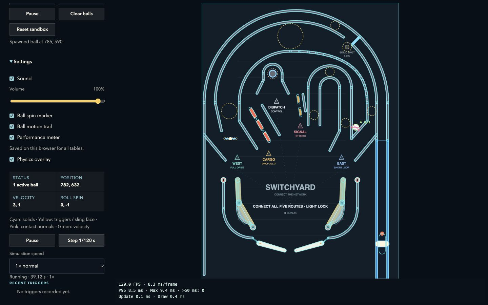
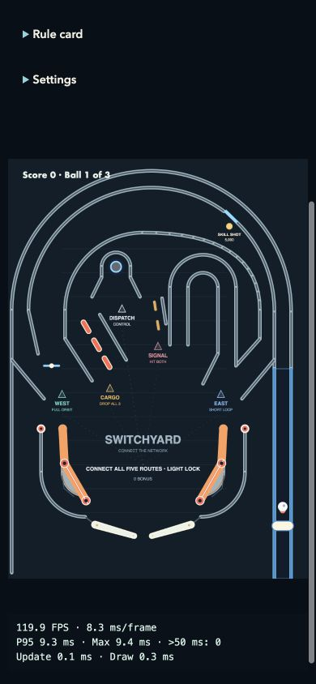

# Just One More and Switchyard playtest — October 10, 2026

Review of revision `caa101a`. The most urgent finding is a reproducible
Switchyard ball trap in the converging West-return/East-loop guides. The next
player-facing priorities are touch instructions, a more compact phone layout,
and readable objective progress. This review changes no gameplay or geometry.

## Scope and limits

Browser review used local Vite development builds in Chrome on the development
Mac. It covered desktop and phone-sized viewports, actual game-loop rendering,
keyboard/touch input handlers, rule cards, numbered-ball transitions, prepared
locks/multiball, and the physics sandbox. Phone viewport overrides change CSS
size; they do not emulate phone hardware, Safari, Android Chrome, device pixel
ratio, touch latency, or browser chrome.

The repeatable browser controller dispatched synthetic keyboard and touch
pointer events through the real input handlers. It reacts to descending balls
near flippers, holds them briefly, and uses a one-second plunger pull. Synthetic
pointer capture was bypassed in the temporary harness because synthetic pointers
have no browser-managed capture. Native pointer capture, simultaneous physical
thumbs, grip comfort, audio unlock on a phone, and real-device performance remain
unverified. The sandbox reproduction used ordinary UI clicks and keyboard nudges.

Separate simulations ran 24 games per table at 120 Hz, seeds 1979–2002, capped
at 120 simulation seconds each. The controller used each board's own flippers
and plunger settings, randomized launch power from 55–100%, handled every live
ball, and did not aim or nudge. All 48 input recordings replayed to identical
complete final states. These results measure this controller, not human skill,
fairness, or enjoyment.

Complete recordings and summaries are retained locally under ignored
`playtest-results/`. The temporary harness and simulation scripts are archived
there as `review-tooling.tar.gz`, with working copies moved outside the repository
after review so they do not enter its normal lint scan. Committed evidence and
minimal reproduction instructions are below.

## Findings and next priorities

| Priority | Finding                                                                                                                                             | Recommended next change                                                                                                                                                       |
| -------- | --------------------------------------------------------------------------------------------------------------------------------------------------- | ----------------------------------------------------------------------------------------------------------------------------------------------------------------------------- |
| 1        | Switchyard can wedge a ball between its converging right-side return guides. Existing speed-based idle detection misses it.                         | Open the return junction and add a physical regression covering this feed; supplement diagnostics with sustained position-displacement checks that exclude legitimate holds.  |
| 2        | Neither table's rule card explains touch controls. The waiting-ball screen has no launch hint, and game over only says “Game over.”                 | Add visible, device-appropriate plunge, flipper, nudge, and replay instructions.                                                                                              |
| 3        | At phone widths, the sidebar comes first, initially hiding the flippers. Small objective text scales to roughly 4–7 CSS pixels.                     | Compact or collapse the phone sidebar and expose the current objective/progress as readable screen-space text. Keep the whole table and lower controls visible together.      |
| 4        | Switchyard's qualification is much less accessible to the untargeted controller than Just One More's. Some fully pulled plunges drain very quickly. | Have people attempt Cargo, Signal, and a complete qualification cycle before changing rules or adding a ball save. Review launch-to-outlane paths and return risk explicitly. |
| 5        | Both tables produced speeds above the existing 4,000-unit/s review threshold.                                                                       | Inspect the recorded high-speed contacts before altering shared physics; current browser timing does not justify a renderer rewrite.                                          |

### Switchyard return trap

In simulated `game-1993`, the ball stopped progressing near
`(781.998624, 632.217712)`. The final position remained exactly unchanged in
10 Hz samples from 71.408 seconds through the 120-second cap. A separate
one-unit-displacement check found approximately 50.92 seconds of stagnation.
The reported linear velocity remained approximately `(5.655472, -0.982836)`,
speed 5.74 units/s. The existing near-rest heuristic requires speed below 5,
so it reported no prolonged idle interval.

The pocket lies between these 12-unit-thick guides:

- West diagonal return: `(840,600)` → `(760,690)`.
- East outer leg: `(760,430)` → `(760,690)`.

The rails converge to a closed point; a descending ball can settle against both
before reaching the junction. This was reached during an ordinary seeded game,
not only by placing a ball in the pocket.

To reproduce through the normal browser UI:

1. Open `/physics?table=switchyard` on desktop.
2. Leave spawn mode at **Replace ball** and all four velocity/spin fields at zero.
3. Enable **Settings → Physics overlay**.
4. Click approximately `(785,590)` in board coordinates, in the narrow space
   just right of East's outer vertical rail and above West's diagonal return.
5. Let it fall. It settles near `(782,632)` and remains there while simulation
   time continues. Dropping directly at the tangent point can be rejected by
   the sandbox's overlap check; start above it instead.

Native left/right/forward nudges briefly moved the ball up inside the pocket,
but it settled back at `(782,632)`. Separate 120 Hz checks applied each nudge
individually to the saved game state, then waited ten seconds; none cleared
it. Resetting the ball is available as a workaround.



A minimal engine reproduction, saved as a temporary TypeScript file in the
repository and executed with `npx vite-node <file>`, is:

```ts
import { switchyardTable as board } from './src/boards/tables/switchyard';
import { createInitialGameState } from './src/game/game-state';
import { initializeRulesState, applyRulesFrame } from './src/game/rules-engine';
import { stepGameFrame } from './src/game/physics-engine';
import { idle } from './src/playtest/simulation';

let state = initializeRulesState(createInitialGameState(board), board);
state.status = 'playing';
state.launcherExited = true;
state.ball.position = { x: 785, y: 590 };
state.ball.linearVelocity = { x: 0, y: 0 };
for (let frame = 0; frame < 1200; frame++) {
  const next = stepGameFrame(state, board, idle, 1 / 120);
  state = applyRulesFrame(next.state, board, next.events, 1 / 120);
}
console.log(state.ball.position, state.ball.linearVelocity);
```

A fix should follow the conventional layout workflow, preserve the distinct
West and East returns, retain the existing route/shot contracts, add this feed
and nearby variations to regression coverage, and repeat all-table validation
and browser review. Passing the current sampled routes does not rule out this
trap.

## Browser observations

The desktop tables fit without cropping the flippers or shooter. Both rule
cards describe their scoring progression accurately. Just One More's PLAY /
FIX / COLLECT inserts provide a compact progression; Switchyard names five
routes and changes their inserts as they connect. The rule cards explain that
Just One More keeps qualification across ordinary drains while Switchyard
resets its network each ball. Opening a card pauses play.

At 390 × 844 with five existing high scores and the performance meter enabled,
both unmodified pages placed the 370 × 518 canvas at approximately y=577 on
initial load. The flippers were below the viewport. Scrolling brought the
entire table into view, without horizontal overflow. Most small shot subtitles
are difficult to read at this scale; Switchyard's 12-unit detail font becomes
approximately 4.4 CSS pixels, and its 18-unit main objective becomes 6.7 pixels.
This limits objective clarity during play even though the readable rule card
is available above the table.

Switchyard also fit a 360 × 800 viewport with a 340 × 476 canvas and no horizontal
overflow. At 844 × 390 landscape, the meter-enabled canvas was only 172 × 242;
it was not cropped, but its text and ball were very small. Portrait is the
more usable layout observed here.



The Just One More touch smoke sequence confirmed two simultaneous flipper
inputs, cancellation clearing both inputs, a downward right-side gesture
holding the plunger, and an upward gesture initiating an up nudge. These were
synthetic event checks; they do not verify native mobile pointer capture.

## Seeded game results

| Metric                                  |   Just One More |      Switchyard |
| --------------------------------------- | --------------: | --------------: |
| Games                                   |              24 |              24 |
| Completed games                         |              24 |              18 |
| Games reaching 120-second cap           |               0 |               6 |
| Completed numbered-ball drains          |              72 |              59 |
| Median completed-ball duration          |         15.33 s |         10.53 s |
| Games reaching a lock and multiball     |               5 |               0 |
| Maximum sampled speed                   | 4,454.7 units/s | 4,428.2 units/s |
| Runs above 4,000 units/s                |              13 |              15 |
| Runs with sustained position stagnation |               0 |               1 |
| Bounds escapes / non-finite states      |           0 / 0 |           0 / 0 |

Completed-ball medians exclude unfinished balls, so Switchyard's six censored
games make this an unsuitable direct difficulty or survival comparison. Five
Switchyard timeouts still had moving balls; one was the confirmed trap.

Just One More's runs hit both spinners, all four repairs, and NEW PIN DAY.
Switchyard's runs hit every Cargo drop and both Signal standups and captured
Dispatch 71 times. At least one full East loop connected in all 24 games,
West in 15, Cargo in six, Signal in three, and Dispatch in four. These counts
record connection at any point in a game, not simultaneous qualification of
all five on one ball. No Switchyard run qualified a lock. Both tables' skill
shots were missed by this randomized-launch controller; a controlled soft
plunge was not part of this batch.

The controller establishes physical access to these objectives, with a clear
qualification imbalance worth examining through deliberate human shots.
It cannot establish that the five-route requirement is unfair. Existing
cradle-shot regressions remain useful evidence of targeted opportunities.

## Browser game and performance measurements

These are individual real-time runs through the input handlers, rather than
fixed-step replays. Browser scheduling changes shot timing, so differences
between keyboard and touch scores are not evidence of a control advantage.

| Table / input                   | Viewport   | Run duration | Final score | Outcome                   |
| ------------------------------- | ---------- | -----------: | ----------: | ------------------------- |
| Just One More / keyboard        | 1440 × 900 |      57.31 s |       9,370 | Three-ball game completed |
| Just One More / synthetic touch | 390 × 844  |      38.40 s |       2,110 | Three-ball game completed |
| Switchyard / keyboard           | 1440 × 900 |       9.49 s |         310 | Three-ball game completed |
| Switchyard / synthetic touch    | 390 × 844  |      28.94 s |      13,660 | Three-ball game completed |

The short Switchyard keyboard run lost its three balls approximately 2.39,
2.21, and 1.72 seconds after their launches. Just One More's touch run also
lost its first ball after approximately 1.77 seconds. The seeded batch had
10 of 72 Just One More numbered-ball drains and 11 of 59 Switchyard drains
within three seconds. These are launch/return review candidates under this
controller, not a measurement of new-player failure rates.

Prepared scenarios qualified the rules through switch events, then performed
an actual physical saucer capture and replacement plunge through the input
handlers. Just One More desktop and Switchyard desktop/phone each reached two
live balls while retaining ball number one on release. Just One More remained
in multiball when its 36.72-second sample ended. Switchyard's 26.72-second
desktop sample returned to single-ball qualification without consuming the turn
when its first live ball drained. Its phone sample also exercised normal ball
advancement afterward. The phone sample included a rule-card pause and ended
at the harness's 65-second wall-time cap; this is not 65 seconds of active play.

While Switchyard's phone rule card was open, score, position, velocity, and ball
number remained unchanged across observations; closing it resumed the game.
The prepared qualification does not establish how readily a person can earn
multiball, and these samples do not constitute an exhaustive jackpot audit.

Across the archived browser-run readouts:

- FPS ranged from 119.2 to 120.7 on this Mac's approximately 120 Hz browser cadence.
- P95 frame intervals ranged from 8.5 to 9.4 ms; the largest reported frame
  interval was 13.5 ms.
- Every sampled two-second window reported zero intervals over 50 ms.
- Mean update CPU time was 0.0–0.2 ms; mean draw submission time was 0.2–0.4 ms.
- The ordinary-game samples recorded no non-finite states or bounds escapes.

Readouts were sampled every two seconds from a meter that itself uses a rolling
two-second window. These ranges are not a continuous whole-session profiler
trace, do not include GPU execution, and include the temporary harness's small
observation/input overhead. Builds and test suites were not run during these
archived timing samples. Phone-sized results still use the Mac's CPU, display,
and Chrome engine. A production-build and physical-device comparison is needed
before making a mobile performance claim or choosing an optimization.

## Verification and remaining acceptance work

Focused layout, rules, and input checks passed: 49 tests across
`switchyard-layout`, `just-one-more-rules`, `switchyard-rules`, and
`keyboard-input`. The minimal engine reproduction above was also executed
successfully. All 525 tests, the production build, and lint passed. All seven
tables passed deep validation with zero errors or warnings. These passing
checks coexist with the confirmed unsampled return trap.

Local high-score lists and the performance-meter preference were restored to
their observed pre-review values. Temporary viewport overrides were reset.
No production analytics were submitted by the localhost sessions.

Physical-phone and human acceptance remain open:

1. On iPhone Safari and Android Chrome, attempt a first plunge without reading
   repository documentation, then hold both flippers, release them separately,
   nudge, cancel a touch, and leave/return to the browser. Check for stuck inputs,
   scrolling, browser gestures, audio unlock, and comfortable thumb placement.
2. Have people deliberately attempt all four repairs on Just One More and
   Cargo/Signal plus the two Express routes on Switchyard. Record whether they
   understand the remaining objectives, can distinguish lit progress, and can
   earn a lock before deciding whether qualification or drain rules need tuning.
3. Measure production-build single-ball and multiball FPS/P95/update/draw on
   those phones, keeping orientation, power mode, and sound settings consistent.
   Desktop viewport checks cannot substitute for these measurements.
